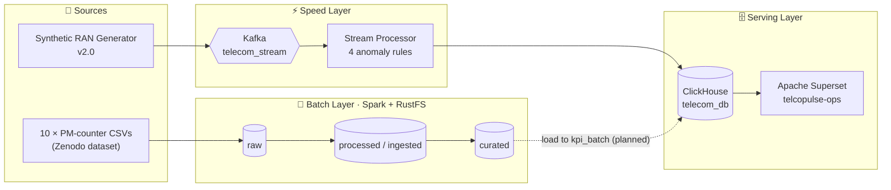
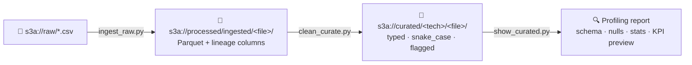
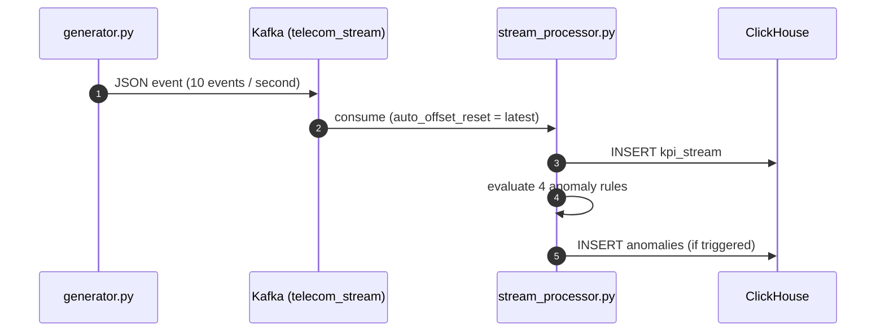
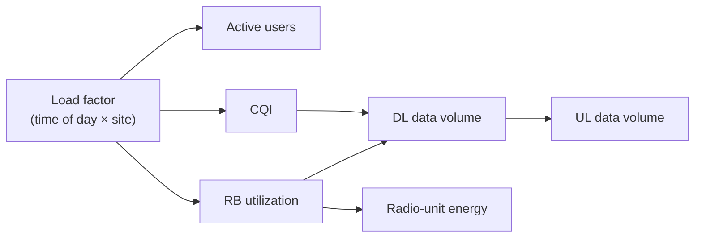
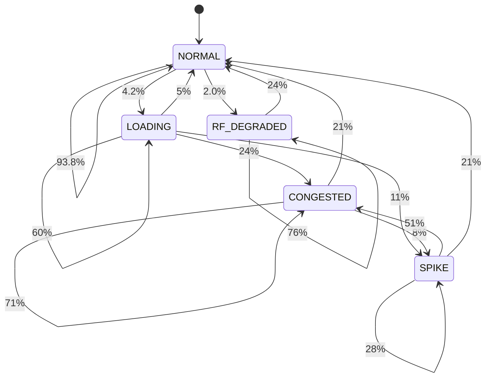

<div align="center">

<br/>

<!-- Animated wave header -->


<!-- Animated typing line -->
<a href="https://github.com/MohammedAhmed-01/TelcoPulseCluster">
  
</a>

<br/><br/>


<br/>

**[Overview](#-overview) · [Results](#-results-at-a-glance) · [Architecture](#-architecture) · [Network](#-network-setup) · [Tech Stack](#-tech-stack) · [Dataset](#-dataset) · [Batch](#-batch-pipeline) · [Streaming](#-streaming-pipeline) · [ClickHouse](#-clickhouse-serving-layer) · [Dashboards](#-dashboards) · [Quick Start](#-quick-start) · [Limitations](#-limitations) · [Team](#-team)**

</div>

<!-- ═══════════════ PIPELINE SHOWCASE ═══════════════ -->


---

## 📖 Overview

**TelcoPulse** is an end-to-end data engineering platform for **Radio Access Network (RAN) analytics**. It ingests historical 5G / 4G / 2G performance-management counters in batch **and** simulates a live telemetry feed, then serves both through a single analytical store with operational dashboards and automated anomaly detection.

The whole stack runs on a **six-laptop home-lab cluster** connected through a local router (Spark master, Kafka broker, ClickHouse/Superset and object storage on separate nodes). That makes it a realistic playground for distributed-systems problems: networking, listener configuration, S3A connectivity, and cross-node data movement.

| | |
|---|---|
| 🎓 **Context** | Huawei HCIA Big Data training · National Telecommunication Institute (NTI) |
| 👨‍🏫 **Presented to** | Eng. Ahmed Hassan |
| 🖥 **Infrastructure** | 6 physical Windows laptops · Docker Desktop (WSL 2) · one local router |
| 📡 **Domain** | 2G / 4G / 5G RAN performance telemetry |
| 📚 **Documentation** | A complete project book accompanies this repository (see [Documentation](#-documentation)) |

### ✨ Highlights

| | Capability | What it does |
|:-:|---|---|
| 🧱 | **Medallion-style lakehouse** | `raw → processed/ingested → curated` Parquet layers on an S3-compatible object store |
| ⚡ | **Distributed Spark processing** | Custom Spark 3.5.9 image with `hadoop-aws` / AWS SDK baked in for S3A access |
| 📡 | **Realistic RAN simulator** | Circadian traffic, site profiles, tech × band calibration, correlated KPIs, Markov anomaly engine |
| 🚨 | **Real-time anomaly detection** | 4 rule-based detectors with severity grading and numeric anomaly scores |
| 🗄️ | **Columnar serving layer** | ClickHouse `MergeTree` tables, partitioned and ordered for fast time-series queries |
| 📊 | **One-command analytics stack** | `setup.sh` boots ClickHouse + Superset and provisions the ops dashboard |
| ✅ | **Built-in data quality checks** | Null / non-numeric / timestamp / duplicate-key audits with row-count reconciliation |

---

## 📈 Results at a Glance

Recorded from the batch curation run (`show_curated.py` output):

| Metric | Value |
|---|--:|
| Source files | **10** CSV files |
| Radio technologies | **3** (2G GSM · 4G LTE · 5G NR) |
| 🟦 LTE rows (curated) | **18,750,012** |
| 🟪 NR rows (curated) | **7,558,148** |
| 🟩 GSM rows (curated) | **5,595,932** |
| **Total curated rows** | **31,904,092** |
| Distinct base stations | **279** |
| Time range | `2023-03-03 08:30:00` → `2025-11-22 23:30:00` |
| Cluster | **6** laptops · 1 router |
| Stream rate (simulator) | **10 events / second** across 4 sites / 21 cells |

> [!NOTE]
> The earlier all-in-one job (`batch_all_10.py`) writes a different, intermediate *Processed* dataset (`telcopulse_batch_v1`). Its row count is **not** comparable to the Curated totals above, because Curated is produced per file by `clean_curate.py`.

---

## 🏗 Architecture

TelcoPulse follows a **Lambda-style design**: a batch layer for historical data, a speed layer for live telemetry, and a shared serving layer.



### 🖥 Cluster Layout

| Node | Role | Services | Key Ports |
|---|---|---|:-:|
| `192.168.1.11` | **Compute** | Spark Master (+ workers / driver) | `7077` `8080` `7078` `7079` |
| `192.168.1.12` | **Object store** | RustFS (S3-compatible) | `9000` API · `9001` console |
| `192.168.1.13` | **Messaging** | Kafka broker (KRaft) + Kafka UI | `9092` `8080` |
| `192.168.1.15` | **Serving** | ClickHouse + Superset | `8123` `9000` `8088` |
| `192.168.1.14` | **Compute** | Spark Worker | `8081` |
| `192.168.1.16` | **Compute** | Spark Worker | `8081` |

> [!NOTE]
> IPs above are the private LAN addresses used in this lab. Change them in `spark-defaults.conf`, the Kafka `ADVERTISED_LISTENERS`, and the Python connection constants to match your network.

---

## 🌐 Network Setup

Every service address is hard-coded in configuration (Spark master URL, S3A endpoint, Kafka advertised listener, ClickHouse URL). If a laptop received a new IP after a reboot, the cluster would break. The lab therefore uses a **DHCP reservation** on the router:

| Step | What to do |
|:-:|---|
| 1 | Connect all laptops to the same router (Wi-Fi or Ethernet). The lab used a Huawei **HG531 V1** (Vodafone ADSL) router at `192.168.1.1`, subnet `255.255.255.0`. |
| 2 | On each laptop run `getmac /v` and note the MAC of the adapter that is actually connected (ignore VMware / Bluetooth adapters). |
| 3 | In the router: **Basic → LAN → DHCP → IP Address Reserve → New**. Enter the MAC (use `:` separators) and the fixed IP. |
| 4 | Reserve one address per laptop in the range `192.168.1.11 – 192.168.1.16`, then press **Submit**. |
| 5 | Reconnect each laptop and verify with `ipconfig`, `ping` and `Test-NetConnection -Port <port>`. |

> [!TIP]
> If a laptop does not get its reserved address, check that Windows "random hardware addresses" is off for the Wi-Fi network and that the MAC belongs to the adapter that is really in use. Step-by-step screenshots are in the project book.

---

## 🧰 Tech Stack

| Layer | Technology | Purpose |
|---|---|---|
| **Object storage** | RustFS | S3-compatible lake with `raw`, `processed`, `curated` buckets |
| **Batch compute** | Apache Spark 3.5.9 (PySpark) | Ingestion, cleaning, curation, profiling |
| **S3 connector** | `hadoop-aws 3.3.4` + `aws-java-sdk-bundle 1.12.262` | `s3a://` access from Spark |
| **Messaging** | Apache Kafka 4.1.0 (KRaft, no ZooKeeper) | Real-time telemetry transport |
| **Kafka tooling** | Kafka UI (Provectus) | Topic / consumer inspection |
| **Stream processing** | Python · `kafka-python` · `requests` | Consume → write KPIs → detect anomalies |
| **Simulation** | Python · NumPy | Physically-correlated synthetic RAN telemetry |
| **Warehouse** | ClickHouse | Columnar OLAP serving layer |
| **BI** | Apache Superset + `clickhouse-connect` | Dashboards and exploration |
| **Orchestration** | Docker · Docker Compose · PowerShell · Bash | Reproducible deployment |

---

## 📦 Dataset

Historical data comes from live-network **performance-management counters** published on Zenodo ([`10.5281/zenodo.17815388`](https://doi.org/10.5281/zenodo.17815388)), recorded at **15-minute intervals**. The generator's field behaviour is additionally calibrated against 4G LTE field traces ([`10.5281/zenodo.1219679`](https://doi.org/10.5281/zenodo.1219679)).

**10 CSV files · 3 dataset groups · 3 radio technologies · 6 frequency bands**

| File | Tech | Band (MHz) |
|---|:-:|:-:|
| `Dataset_01_LTE_2100.csv` | 4G LTE | 2100 |
| `Dataset_01_NR_1800.csv` | 5G NR | 1800 |
| `Dataset_02_LTE_1800.csv` | 4G LTE | 1800 |
| `Dataset_02_NR_2100.csv` | 5G NR | 2100 |
| `Dataset_03_GSM_900.csv` | 2G GSM | 900 |
| `Dataset_03_LTE_1800.csv` | 4G LTE | 1800 |
| `Dataset_03_LTE_700.csv` | 4G LTE | 700 |
| `Dataset_03_LTE_800.csv` | 4G LTE | 800 |
| `Dataset_03_NR_2100.csv` | 5G NR | 2100 |
| `Dataset_03_NR_3500.csv` | 5G NR | 3500 |

Technology and frequency are parsed directly from the **file name** (`Dataset_<group>_<TECH>_<MHz>.csv`) and attached as columns during ingestion.

---

## 🧱 Batch Pipeline

Three Spark jobs implement a clean **raw → ingested → curated** flow. Each job is re-runnable and prints greppable, prefixed log lines (`INGEST`, `CHECK`, `CLEAN`, `DONE`, `SHOW`).



### 1️⃣ `ingest_raw.py` — Raw → Parquet

- Reads every CSV with `header=true` and **no schema inference** (everything stays a string, so nothing is silently coerced).
- Adds lineage columns: `source_file`, `technology`, `frequency_mhz`, `processed_at`.
- Writes Parquet and **re-reads the output to verify** `rows_in == rows_out` (`OK` / `MISMATCH`).

### 2️⃣ `clean_curate.py` — Quality Audit + Curation

For every file, the job audits first, then transforms:

| Check | Description |
|---|---|
| ⏱ **Timestamp parse failures** | Rows whose `Timestamp` cannot be parsed |
| 🔑 **Null keys** | Rows missing `Base station` or `Sector` |
| 🕳 **Empty values** | Per-column count of null / blank metric cells |
| 🔤 **Non-numeric values** | Per-column count of values that fail `cast("double")` |
| 👯 **Duplicate keys** | Duplicates on `(Base station, Sector, Timestamp)` — **reported, not deleted** |
| ⚖️ **Row reconciliation** | Output row count must equal input row count |

Curation then:

- Normalizes column names to **`snake_case`** and strips technology prefixes (`4G `, `5G `, `2G `).
- Casts energy and KPI columns to `double`, and `Timestamp` → `ts`.
- Adds **`has_network_metrics`** — a boolean flag marking rows where at least one KPI is present (energy-only rows stay, but are distinguishable).
- Writes to `s3a://curated/<lte|nr|gsm>/<dataset>/`.

### 3️⃣ `show_curated.py` — Curated-Layer Profiling

Prints, per technology: schema, row counts per source file, time range, distinct base stations/sectors, null counts, `count/min/mean/max` summaries, sample rows, and KPI previews (average per frequency and per hour of day).

### 🧪 `batch_all_10.py` — Single-Pass Alternative

An earlier all-in-one version that reads all 10 files, tags them, unions them with `unionByName(allowMissingColumns=True)`, and writes one Parquet dataset (`repartition(12)`) to `s3a://processed/telcopulse_batch_v1/`.

---

## ⚡ Streaming Pipeline



### 📡 Synthetic RAN Generator `v2.0`

A drop-in simulator that emits **one event every 0.1 s**, each representing a 5-minute measurement window, across **4 sites / 21 cells**.

| Design Pillar | Details |
|---|---|
| 🌅 **Circadian traffic model** | Dual Gaussian peaks (business ≈ 10:00, evening ≈ 20:00), separate weekday / weekend curves |
| 🏙 **Site profiles** | Urban, suburban, rural — each with its own load scale and tech/band stack |
| 📻 **Tech × Band calibration** | Separate KPI envelopes for 4G @ 1800 / 2100 and 5G @ 3500 / 1800 |
| 🔗 **Correlated KPI chain** | load → users → RB utilization → CQI → throughput volume → UL ratio → energy |
| 🎲 **Markov anomaly engine** | 5-state per-cell chain with realistic transition probabilities |
| 📈 **Log-normal noise** | Captures bursty, right-skewed real-world traffic |

**Simulated sites**

| Site | Type | Tech / Band | Sectors | Load Scale |
|---|---|---|:-:|:-:|
| Site 36 | Urban | 4G@1800, 5G@3500 | 3 | 1.20 |
| Site 42 | Urban | 4G@2100, 5G@3500 | 3 | 1.10 |
| Site 88 | Suburban | 4G@1800, 4G@2100 | 3 | 0.75 |
| Site 101 | Rural | 4G@1800 | 3 | 0.35 |

**KPI correlation chain**



**Anomaly state machine** (one chain per cell, advanced every event)



| State | `scenario_id` | Effect on KPIs |
|---|---|---|
| 🟢 Normal | `normal` | Baseline circadian behaviour |
| 🟡 Loading | `loading` | RB utilization ramps up |
| 🟠 Congested | `congested` | RB util > 80 %, CQI degrades |
| 🔴 Spike | `traffic_spike` | DL volume ×2–3.8, RB util surges |
| 🟣 RF degraded | `rf_degradation` | CQI collapses, DL volume drops to 20–50 % |

### 🚨 Stream Processor — Anomaly Rules

Every Kafka event is written to `kpi_stream`, then evaluated against four rules. Each hit becomes a row in `anomalies` with an `anomaly_score` and a `severity`.

| # | Rule | KPI | Trigger | Severity |
|:-:|---|---|---|---|
| 1 | **RB utilization spike** | `rb_utilization` | `> 80 %` | `warning` · `critical` when `> 90 %` |
| 2 | **Throughput collapse** | `data_volume_dl` | `< 15 MB` while `users > 5` | graded by score (`info` / `warning` / `critical`) |
| 3 | **Radio quality degradation** | `radio_quality_cqi` | `< 6.0` | `warning` · `critical` when `< 4.0` |
| 4 | **Energy anomaly** | `radio_unit_energy` | above ceiling: 4G `125 W`, 5G `250 W` | graded by score |

Score-based severity: `≥ 1.5 → critical` · `≥ 1.0 → warning` · otherwise `info`.

---

## 🗄 ClickHouse Serving Layer

Database: **`telecom_db`** — all tables use the `MergeTree` engine with `LowCardinality` strings and time-based partitioning/ordering.

| Table | Purpose | Partition | Order By |
|---|---|---|---|
| `kpi_batch` | Historical KPIs, **25-column** multi-technology schema | `toYYYYMM(ts)` | `base_station, technology, ts` |
| `kpi_stream` | Windowed real-time KPIs from Kafka | `toDate(window_start)` | `base_station, window_start` |
| `anomalies` | Detected network anomalies with severity and score | — | `detected_at, severity, base_station` |
| `quality_report` | Data-quality audit results per layer | — | `check_timestamp` |
| `benchmark_runs` | Ingestion-rate and query-latency verification | — | `executed_at` |

<details>
<summary><b>📋 View the 25 columns of <code>kpi_batch</code></b></summary>

<br/>

| Group | Columns |
|---|---|
| **Identity** | `ts`, `base_station`, `sector`, `technology`, `frequency_mhz`, `bandwidth_mhz` |
| **Traffic** | `data_volume_dl`, `data_volume_ul`, `throughput_dl_mbps`, `throughput_ul_mbps` |
| **Users** | `active_users_dl`, `active_users_ul`, `max_active_users_dl` |
| **Radio** | `rb_utilization`, `cqi_mean`, `mcs_mean`, `mimo_layers`, `tx_power_dbm`, `coverage_distance_km` |
| **Quality** | `packet_loss_rate`, `latency_ms` |
| **Energy / Thermal** | `radio_unit_energy_consumption`, `baseband_energy_consumption`, `cooling_energy_consumption`, `power_amplifier_temp` |

</details>

Schema file: [`Clickhouse/01_init_schema.sql`](Clickhouse/01_init_schema.sql)

---

## 📊 Dashboards

Apache Superset is provisioned automatically by `setup.sh` — admin user, ClickHouse driver, charts, and the **TelcoPulse Ops** dashboard.

| | |
|---|---|
| **URL** | `http://localhost:8088/superset/dashboard/telcopulse-ops/` |
| **Datasource** | ClickHouse `telecom_db` over HTTP (`8123`) |
| **Provisioning** | `superset/provision_dashboard.py` |

---

## 🗂 Repository Structure

```text
TelcoPulseCluster/
├── 📁 Document/
│   └── TelcoPulse_showcase.gif        # pipeline showcase animation
├── 📁 docker/
│   ├── docker-compose.yml             # Spark master
│   ├── rustfs-compose.yml             # RustFS object store
│   └── spark/
│       ├── Dockerfile                 # Spark 3.5.9 + S3A jars
│       └── batch_all_10.py            # single-pass batch job
├── 📁 jobs/
│   ├── ingest_raw.py                  # CSV  → Parquet (ingested)
│   ├── clean_curate.py                # audit + typed, curated Parquet
│   ├── show_curated.py                # curated-layer profiling
│   └── Order.txt                      # run order / commands
├── 📁 kafka-cluster/
│   ├── docker-compose.yml             # Kafka (KRaft) + Kafka UI
│   ├── generator.py                   # synthetic RAN telemetry producer
│   └── stream_processor.py            # consumer + anomaly detection
├── 📁 Clickhouse/
│   └── 01_init_schema.sql             # telecom_db schema (5 tables)
├── 📁 superset/
│   ├── superset_config.py
│   └── provision_dashboard.py
├── docker-compose.yml                 # ClickHouse + Superset (+ Kafka sim)
├── spark-defaults.conf                # Spark networking / ports
├── rustfs.env                         # storage credentials (lab values: do NOT reuse)
└── setup.sh                           # one-command analytics bootstrap
```

---

## 🚀 Quick Start

### Prerequisites

- Docker & Docker Compose
- Python 3.10+ (`pip install kafka-python numpy requests`)
- PowerShell (Windows) for the Spark job commands, Bash for `setup.sh`
- Datasets uploaded to the `raw` bucket
- Fixed LAN addresses for each node (see [Network Setup](#-network-setup))

### 1. Start the object store (RustFS)

```bash
docker compose -f docker/rustfs-compose.yml up -d
# API: http://localhost:9000   ·   Console: http://localhost:9001
```

Create three buckets in the console: **`raw`**, **`processed`**, **`curated`**, then upload the 10 CSVs into `raw`.

### 2. Build the Spark image and start the master

```bash
docker build -t telcopulse-spark-s3a:3.5.9 docker/spark
docker compose -f docker/docker-compose.yml up -d
# Spark UI: http://<master-ip>:8080
```

### 3. Run the batch pipeline

```powershell
# One-time per shell: sets $JOBS and the $conf array of spark-submit options
. .\env.ps1

# 1) Ingest raw CSVs → Parquet
docker run --rm -p 7080:7080 -p 7081:7081 -p 4040:4040 -v "${JOBS}:/jobs" `
  telcopulse-spark-s3a:3.5.9 /opt/spark/bin/spark-submit @conf /jobs/ingest_raw.py all `
  > jobs\ingest_out.txt 2>&1
Select-String -Path jobs\ingest_out.txt -Pattern "^INGEST"

# 2) Audit, clean and curate
docker run --rm -p 7080:7080 -p 7081:7081 -p 4040:4040 -v "${JOBS}:/jobs" `
  telcopulse-spark-s3a:3.5.9 /opt/spark/bin/spark-submit @conf /jobs/clean_curate.py all `
  > jobs\clean_out.txt 2>&1
Select-String -Path jobs\clean_out.txt -Pattern "^(CHECK|CLEAN|DONE)"

# 3) Inspect the curated layer
docker run --rm -p 7080:7080 -p 7081:7081 -p 4040:4040 -v "${JOBS}:/jobs" `
  telcopulse-spark-s3a:3.5.9 /opt/spark/bin/spark-submit @conf /jobs/show_curated.py `
  > jobs\show_out.txt 2>&1
Select-String -Path jobs\show_out.txt -Pattern "^SHOW|^\||^\+-"
```

> [!TIP]
> Both `ingest_raw.py` and `clean_curate.py` accept `all` **or** specific files (e.g. `Dataset_03_NR_3500`), so you can re-run a single dataset.

### 4. Launch the analytics stack (ClickHouse + Superset)

```bash
export SUPERSET_SECRET_KEY="<your-own-secret>"
bash setup.sh
```

Then apply the schema:

```bash
cat Clickhouse/01_init_schema.sql | docker exec -i clickhouse-node5 clickhouse-client --multiquery
```

### 5. Start the streaming pipeline

```bash
# Kafka broker + Kafka UI
docker compose -f kafka-cluster/docker-compose.yml up -d

# Terminal A — produce synthetic telemetry
python kafka-cluster/generator.py

# Terminal B — consume, store, detect anomalies
python kafka-cluster/stream_processor.py
```

Watch it live: **Kafka UI** → `http://<kafka-host>:8080` · **Superset** → `http://localhost:8088`

---

## ⚙️ Configuration Reference

| Setting | Where | Default / Example |
|---|---|---|
| Spark master URL | `batch_all_10.py`, `spark-defaults.conf` | `spark://192.168.1.11:7077` |
| Spark driver ports | `spark-defaults.conf` | driver `7078` · block manager `7079` |
| Kafka bootstrap (producer) | `generator.py` → `KAFKA_BROKER` | `localhost:9092` |
| Kafka bootstrap (consumer) | `stream_processor.py` → `KAFKA_BROKER` | `192.168.1.13:9092` |
| Kafka topic | both scripts | `telecom_stream` |
| Emit interval / window | `generator.py` | `0.10 s` / `300 s` |
| ClickHouse HTTP endpoint | `stream_processor.py` → `CLICKHOUSE_URL` | `http://192.168.1.15:8123/` |
| Kafka listeners | `kafka-cluster/docker-compose.yml` | `INTERNAL :29092` · `EXTERNAL :9092` · `CONTROLLER :9093` |
| Credentials & secrets | `rustfs.env`, compose files, `CH_AUTH` | ⚠️ lab values only — use env vars / `.env` for anything else |

> [!WARNING]
> The credentials in this repository are **lab-only values** for an isolated local network. Never reuse them. For any other deployment, move access keys, database passwords and `SUPERSET_SECRET_KEY` into environment variables or an untracked `.env` file, and add those files to `.gitignore`.

---

## 📚 Documentation

A complete **project book** (architecture, router and network setup with screenshots, every pipeline, ClickHouse schemas, dashboards, testing, troubleshooting and operations runbooks) accompanies this repository: `Document/TelcoPulse_Complete_Project_Book.docx`.

---

## ⚠️ Limitations

Being explicit about scope is part of the engineering:

| Area | Current state |
|---|---|
| **High availability** | Single Kafka broker (replication factor 1), single Spark master, single ClickHouse node. A node failure interrupts the affected service; no failover has been tested. |
| **Anomaly detection** | Rule-based thresholds only (4 rules). No statistical or machine-learning detector yet. |
| **Streaming source** | Synthetic generator, not live network telemetry. Stream results must not be read as real-network measurements. |
| **Stream processor** | Plain Python consumer, not Spark Structured Streaming. |
| **Batch → ClickHouse** | Curated Parquet is not yet loaded into `kpi_batch` by an automated job (see roadmap). |
| **Quality / benchmark tables** | `quality_report` and `benchmark_runs` exist in the schema but are not populated automatically yet. |
| **Network** | Home-lab router with mixed Wi-Fi / Ethernet. Throughput and latency are not representative of a wired data-centre fabric. |
| **Security** | Lab credentials, plain HTTP, no TLS, no authentication on internal services. |

---

## 🧭 Roadmap

- [ ] Spark job to load the curated layer into `clickhouse.kpi_batch`
- [ ] Spark Structured Streaming variant of the stream processor
- [ ] Statistical / ML anomaly detection alongside the threshold rules
- [ ] Populate `quality_report` and `benchmark_runs` automatically from the pipeline
- [ ] Multi-broker Kafka and multi-master Spark for high availability
- [ ] Monitoring (Prometheus + Grafana)
- [ ] Orchestration with Airflow
- [ ] Alerting (email / webhook) on `critical` anomalies

---

## ✅ Conclusion

TelcoPulse shows that a realistic telecom analytics platform can be built end to end on ordinary hardware: **31.9 million curated records** from 2G, 4G and 5G networks flow through a Spark-based lakehouse on S3-compatible storage, while a simulated live feed passes through Kafka into ClickHouse with rule-based anomaly detection, all visualised in Apache Superset. The project also exposes the practical side of distributed systems: fixed addressing, listener configuration, S3A connectivity and cross-node networking. Its main limits (no high availability, rule-based detection only) are documented above and drive the roadmap.

---

## 👥 Team

| Role | Name |
|---|---|---|
| Member | **Mahmoud Saleh** |
| Member | **Ali Tharwat** | 
| Member | **Youssef ElToor** | 
| Member | **Mohamed Saleh** |
| Member | **Basel Tarek** | 

| | |
|---|---|
| **Training** | Huawei HCIA Big Data · National Telecommunication Institute (NTI) |
| **Presented to** | Eng. Ahmed Hassan |
| **Project period** | October 2026 |
| **GitHub** | [github.com/MohammedAhmed-01/TelcoPulseCluster](https://github.com/MohammedAhmed-01/TelcoPulseCluster) |

<div align="center">

*TelcoPulse · Batch + Real-Time Telecom RAN Analytics Platform · Built for the Huawei HCIA Big Data programme at NTI*

</div>
